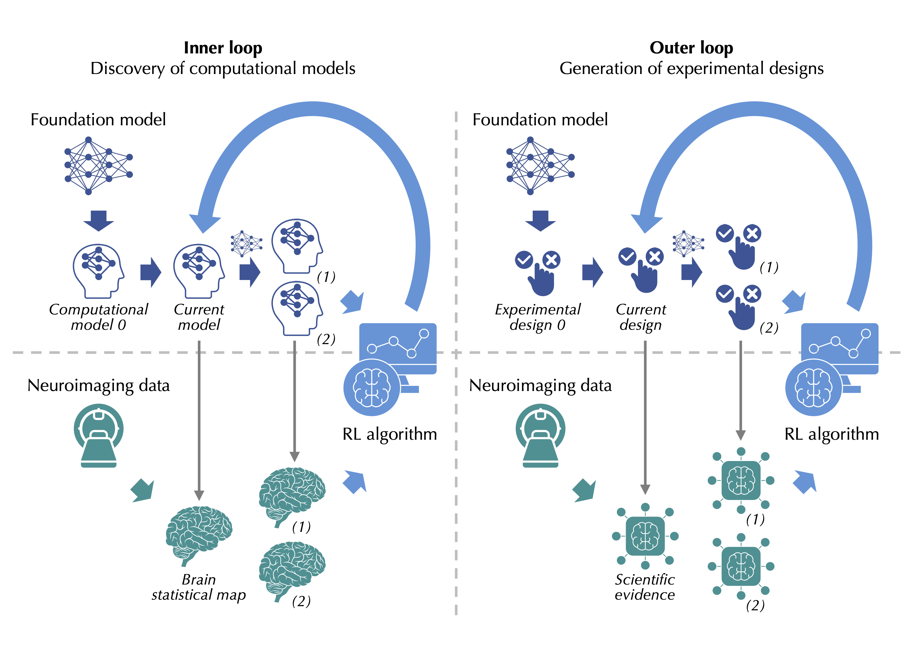
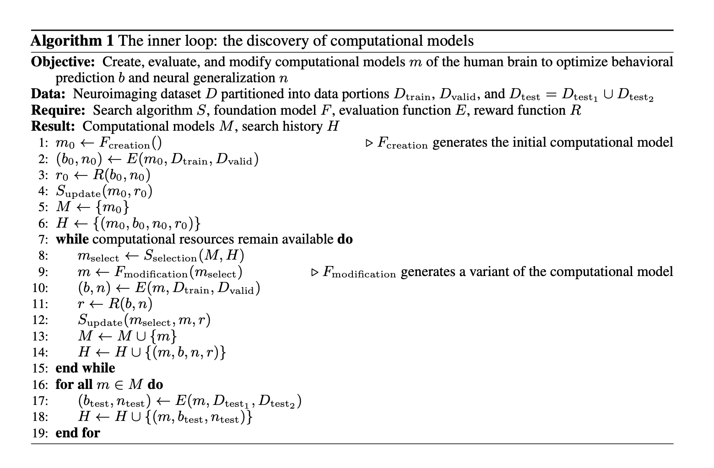
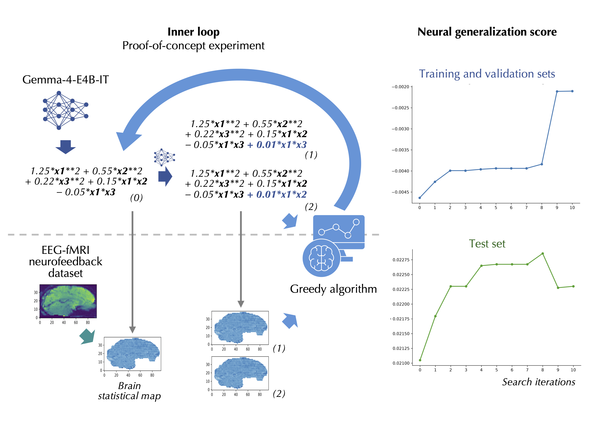

# ouroboros_rl_x_llm

## Ouroboros RL x LLM: Reinforcement Learning and Large Language Models for the Discovery of Computational Models of the Human Brain

#### Maël Donoso, [Ouroboros Neurotechnologies](https://ouroboros-neurotechnologies.com/)

### Abstract

**The exploration of a large search space and the optimization of scientific experiments are two important applications of reinforcement learning for scientific research. Among the experimental sciences that could benefit from reinforcement learning methods, cognitive and computational neuroscience presents a distinctive form of the simulation-to-reality problem. In this project, we explore the potential of integrating reinforcement learning and foundation models for accelerating the discovery of computational models of the human brain. We introduce a two-level framework, in which the proposed inner loop focuses on creating, evaluating, and modifying computational models, whereas the more forward-looking outer loop builds upon the inner loop to generate new experimental designs. We suggest that two relevant optimization objectives for the inner loop could be behavioral prediction and neural generalization, and that large language models could be used to provide scientific priors and help define the scientific search space to explore. We also note that several levels of integration of reinforcement learning and foundation models could be envisioned, and discuss the limitations, challenges, and opportunities of this strategy. This repository presents a minimal proof-of-concept experiment to illustrate some of the fundamental building blocks of the inner loop.**

### Introduction

Reinforcement learning (RL) has demonstrated its potential for advancing scientific research along two important dimensions: the exploration of a large search space and the optimization of scientific experiments. Regarding the exploration of a large search space, RL methods have been used, in particular, to discover faster matrix multiplication and sorting algorithms, and to design novel organic radicals and proteins. Regarding the optimization of scientific experiments, remarkable examples of RL applications include cold atom experiments, stratospheric balloon navigation, and whale observation, as well as closed-loop scientific discovery in the context of multi-step chemistry, reaction conditions, and protein design. Bridging the simulation-to-reality gap, that is, transferring advances from simulated environments to real experimental conditions, has emerged as one of the current frontiers in RL research. Successful transfers have been achieved in a variety of scientific contexts, including the control of particle accelerators, tokamak plasmas, and colloidal crystals. 

Among the experimental sciences that could benefit from RL methods, cognitive and computational neuroscience occupies arguably a distinctive position. Whereas simulations in other scientific domains can often systematically rely on physical, chemical, or biological principles to constrain the search space, as is also the case for lower levels of organization in neuroscience such as neurons and microcircuits, research on human cognition follows a different path. The objective of cognitive and computational neuroscience is to develop increasingly accurate computational models of the human brain, which must be able to perform the cognitive tasks of interest while being consistent with the behavioral and neural data acquired on human subjects. Therefore, the development of a computational model can be viewed as a distinctive form of the simulation-to-reality problem, where instead of a single transition from simulated environment to real-world setting, the scientific process requires an iteration between modifying the model and evaluating its performance and generalization on behavioral and neural data. Theoretically, such an iterative process could be a strong candidate for RL-guided scientific discovery. Practically, since computational models of human cognition are open-ended and not systematically built upon a well-defined set of physical, chemical, or biological principles, the application of RL methods in cognitive and computational neuroscience faces a significant challenge: defining the search space to explore. 

Foundation models such as large language models (LLMs) could help address this issue by providing relevant scientific priors for creating and modifying computational models of the human brain. Large deep learning models have unlocked significant scientific discoveries by predicting the structure of proteins or discovering new materials, and new foundation models are regularly developed in chemistry, biology, or neuroscience. LLMs, in particular, have demonstrated their utility for accelerating scientific research in mathematics, chemistry, or biology. Remarkably, LLMs trained on a broad corpus of human language, which is assumed to include a significant amount of neuroscience literature, are capable of extracting relevant scientific knowledge on the human brain across several neuroimaging modalities **[1]**. Therefore, although the scientific priors provided by LLMs should not be considered as a ground truth, they could represent an attractive solution for helping define the search space to explore, and potentially support the application of RL methods for scientific discovery in cognitive and computational neuroscience. In this project, we explore the potential of integrating RL and foundation models for iteratively creating, evaluating, and modifying computational models of the human brain, a process which we define as the *inner loop*. We also discuss how this strategy could serve as a basis for optimizing future experiments by generating new experimental designs, a process which we define as the *outer loop*. 

### Scientific discovery in cognitive and computational neuroscience

Computational models of the human brain are very diverse, as are the cognitive functions that these models are designed to explain. For example, the neural foundations of reward-based learning have been investigated using actor-critic, Bayesian learning, or temporal-difference learning computational models. Studies on the neural foundations of value, motivation, and confidence have considered RL algorithms, as well as discounting, foraging, or race models. Finally, research on the neural foundations of decision-making and reasoning has relied on Bayesian RL, and introduced new models building upon RL or integrating RL, Bayesian inference, and hypothesis testing. While the choice of a computational model is a fundamental scientific question in cognitive and computational neuroscience, it is also worth noting that some studies do not explicitly rely on a formal learning algorithm, even when higher-order cognitive functions are considered. For example, the brain regions associated with valuation, motivation, or executive function can be directly characterized using an experimental design that elicits the computational processes of interest. Importantly, the acquisition of new neuroimaging datasets is often motivated by the fact that available data is insufficient to distinguish between several possible models. This suggests that the evaluation of candidate models using RL methods may directly inform the future experiments to consider, by highlighting the uncertainties or ambiguities whose resolution could benefit the most from additional neuroimaging data. 

### The inner loop: the discovery of computational models

#### Defining the optimization objective

What do neuroscientists aim to optimize when they explore possible computational models of the human brain, for example in the context of a functional magnetic resonance imaging (fMRI) experiment? We suggest that two relevant optimization objectives could be *behavioral prediction* and *neural generalization*. Behavioral prediction directly addresses the idea that computational models must be able to perform the cognitive tasks of interest. Depending on the experiment, the performance of a model in predicting human behavior could be relatively straightforward to evaluate, for example if the human subject is asked to select an action within a limited set of possibilities. However, it could also require more sophisticated metrics, in particular when actions are continuous, asynchronous, or open-ended, or when some classes of actions must be weighted more than others. While behavioral prediction and neural generalization may be combined within a single optimization objective, for example by weighting their respective contributions with a coefficient, behavioral prediction could also be used as a filter for selecting computational models only when they are reasonably consistent with human behavior. Neural generalization, in any case, is arguably one of the most distinctive objectives in cognitive and computational neuroscience, where experiments focus on uncovering reproducible neural patterns across trials, conditions, or subjects; the exact nature of these neural patterns is dependent on the spatial resolution, temporal resolution, and other characteristics of each neuroimaging modality. Alongside neural generalization, *neural prediction*, defined as the capacity of a model to explain the variance in brain data, could also be a legitimate objective, even if it can be challenging for complex models. Nevertheless, we consider neural generalization to be a more natural candidate, because evaluating whether a model yields reproducible results across independent data portions seems to be a meaningful objective overall. By contrast, assessing whether a model explains a substantial proportion of brain activity could be more challenging for subtle cognitive functions, whose contribution to the neural variance is expected to be low. 

Typically, a model-based fMRI experiment involves fitting the parameters of a computational model on the behavioral data, extracting the time series of the variables predicted by the model, and finding the brain regions whose neural activity correlates with these variables. Specifically, the fMRI scanner records a blood-oxygen-level-dependent (BOLD) signal, while the computational variables are convolved with the hemodynamic response function (HRF) to generate a predicted BOLD response. The convolved regressors are then entered into a general linear model which estimates their association with the recorded data, producing brain statistical maps. For a single variable, a relatively straightforward manner to evaluate neural generalization could be to compute the brain statistical maps on both a training set and a validation set, and to measure a similarity score between the two maps by using, for example, Pearson correlation. For multiple variables, the correlation coefficients could be aggregated, for example, by applying a Fisher transformation and averaging the results across variables. Such a similarity measure could be performed directly on the group-level statistical maps summarizing the effects across participants, but an alternative method for preserving individual effects may be to conduct the analysis on the subject-level statistical maps, and only then to average the similarity scores at the group level. Since comparing the neural correlates of computational variables is a relatively general process, this method could be extended to other forms of neural patterns, such as functional connectivity. 

While behavioral prediction and neural generalization could provide a baseline for evaluating candidate computational models, many additional criteria could be added as well, depending on the scientific objective. Here, we provide a few examples. (1) *Complexity*: the optimization process could favor simple models by introducing a regularization based on the number of parameters, or allow for more complex and expressive models. (2) *Spatial organization*: the optimization process could favor models whose variables are associated with well-defined, anatomically coherent brain regions. (3) *Spatial specificity*: the optimization process could favor models whose variables are associated with distinct, rather than overlapping, brain regions. (4) *Neural prediction*: as mentioned earlier, the optimization process could favor models explaining a higher proportion of the neural variance. (5) *Functional specificity*: if orthogonalization is applied and if the order in which the variables are orthogonalized can be modified, the optimization process could favor orderings where the most important variables are orthogonalized last, since this would isolate their specific contribution after removing the variance shared with the preceding variables. Although our discussion has focused on encoding models, where brain activity must be predicted from environmental or behavioral features, it is worth noting that this strategy could be extended to decoding models, where environmental or behavioral features must be predicted from brain activity. In this case, the relevant optimization objective would conventionally be called *decoding performance*, and candidate computational models would likely be evaluated based on the accuracy of their predictions. 

#### Running the reinforcement learning process

Once the optimization objective is defined, the inner loop can be formulated as a Markov decision process over the search space of possible computational models of the human brain. Within this process, states correspond to the computational models, actions correspond to the modifications applied to these models, and rewards are defined by the combination of behavioral prediction and neural generalization, including any additional criteria. It should be noted that rewards need two sets to be computed, since neural generalization is evaluated by comparing different brain statistical maps. In the proposed algorithm, the initial step is the creation of a model, which may be supported by an LLM, as we will soon discuss. Then, the behavioral prediction and neural generalization of the model are evaluated on the training and validation sets, and combined to constitute the reward. The model receives a modification, which may again be supported by an LLM, and the process iterates. Eventually, the behavioral prediction of each model can be evaluated on a held-out test set, with the neural generalization assessed between two distinct portions of this test set, revealing whether the process has resulted in an improvement. Several model modifications may be applied at each iteration, resulting in several model variants, in which case only the selected variants may need to be evaluated on the test set. Depending on the available neuroimaging data, the fixed partition could be replaced by more sophisticated resampling or cross-validation schemes, varying for example the subjects or conditions allocated to the training and validation sets across repeated evaluations. If required, the model could also be fitted on the behavioral data before being evaluated. 

This strategy is defined in a relatively algorithm-agnostic manner, in the sense that several RL algorithms could potentially be considered to conduct the search. The choice of an algorithm could depend on the branching factor, corresponding to the number of model modifications that may be considered at each step, but also on other factors, such as the depth of the search or the computational resources required for the evaluation. Monte-Carlo Tree Search (MCTS) could represent a good starting point, since this algorithm is well-suited for search problems that can be defined as a sequence of discrete, compositional choices, as is the case for successive modifications of a computational model. Furthermore, while MCTS allocates evaluations preferentially to promising branches, it maintains some degree of exploration, which could be useful to preserve flexibility and potentially uncover unexpected computational solutions. GFlowNets could provide an interesting alternative to MCTS, particularly if the objective is to generate a diverse set of relevant computational models, rather than to converge on a single one. While the computational resources required for the evaluation would certainly be a limiting factor for any RL or related search algorithm, it seems reasonable to assume that the results of several operations could be cached and reused across steps. Specifically, if model modifications are relatively focused and leave some variables unchanged from one step to another, it should be possible to maintain the time series and convolved regressors of these variables. If these unchanged variables are orthogonalized first, such that their neural correlates are unaffected by the variance of modified regressors, it should even be possible to preserve their brain statistical maps, thereby saving substantial computational resources. 

#### Foundation models and the scientific search space

The inner loop depends on two non-trivial operations: the creation and modification of computational models of the human brain, which together define the search space that RL or related search algorithms could explore. Foundation models, particularly LLMs trained on a broad corpus of neuroscience literature and other sources of knowledge, could support these operations by providing relevant scientific priors. Specifically, they could be used to generate the initial computational model, and then, at each iteration, to generate the set of plausible modifications that could be applied to the current model. The integration of RL and LLMs for iteratively creating, evaluating, and modifying models requires that these models can be consistently specified using some formal representation, such as a computational graph, and that this representation can be rendered executable. Importantly, although we mentioned classical research in cognitive and computational neuroscience, where the models are often relatively simple, this strategy could be extended to more complex models, such as deep learning models, provided that the modifications are adapted accordingly. For simple models, modifications could include adding, removing, splitting, or merging variables, changing updating rules, or adapting decision thresholds. For deep learning models, modifications could include adding, removing, or reshaping neural network layers, adding or removing shortcut connections, changing activation functions, selecting the trainable neural network layers, or modifying the training or regularization parameters. Since neural networks can be effectively represented as computational graphs, using LLMs to create and modify deep learning models should be possible, and perhaps more straightforward than for classical models. Fundamentally, by providing scientific priors based on neuroscience literature and other sources of knowledge, LLMs could help define the scientific search space needed to orient the optimization process, and transform the discovery of computational models of the human brain from an open-ended problem to a more tractable scientific endeavor. 

Several levels of integration of RL and LLMs could be envisioned. The simplest method, which we discussed, uses an LLM to create and modify computational models, while MCTS or another algorithm explores the most promising branches. However, the interaction between the two components would remain limited, since the algorithm does not communicate the history of states, actions, and rewards to the LLM, and the LLM cannot adapt future generations based on this past trajectory. A more advanced method could provide the LLM with additional context, so that the search history could be directly used to suggest model modifications. For example, if the introduction of adaptive learning rates or uncertainty monitoring has proved particularly beneficial in the past, the LLM may be prompted to further explore these paths by proposing modifications that develop these functions, all the while maintaining some degree of exploration to preserve flexibility. As a result, the optimization process would be driven not only by the algorithm, but by the combined effect of the algorithm and the scientific priors provided by the LLM. An even more advanced and forward-looking method could be to embed each computational model into a common vector representation, so that the optimization process could be driven by the exploration of a scientific latent space. Encoder-decoder models have already been successfully used for embedding mathematical expressions, computer programs, and neural network architectures, suggesting that they might be applied to computational models of the human brain as well. This hypothetical scenario assumes that computational models could be consistently encoded into a latent space where nearby vectors correspond to scientifically related models, and successfully decoded into executable representations. It is worth noting that if these conditions were satisfied, LLMs may no longer be strictly necessary, since the encoder-decoder models would directly provide the relevant scientific priors for the optimization process. 

### The outer loop: the generation of experimental designs

Building upon the inner loop, the outer loop can be formulated as a Markov decision process over the search space of possible experimental designs in cognitive and computational neuroscience. Within this process, states correspond to available scientific evidence, actions correspond to new experimental designs, and rewards could be defined, for example, by whether or not the new experiments based on these designs have helped distinguish between competing computational models of the human brain. Although the outer loop is arguably closer to current applications of RL for the organization of scientific experiments, it should be noted that this process seems currently more speculative than the inner loop. In principle, the integration of RL and foundation models might be used to create, evaluate, and modify experimental designs, and dedicated software might be able to translate these designs into experiment control programs, capable of presenting stimuli and recording actions. However, because experiments in cognitive and computational neuroscience involve human subjects, not only must experimental protocols be thoughtfully designed and proactively evaluated, but physical interactions remain necessary for welcoming, setting up, and ensuring the safety and comfort of the participants. This suggests that full automation seems unlikely at this stage, and that end-to-end human oversight could remain necessary in the foreseeable future. The situation could change if neural interfaces become more widely used, and if portable neuroimaging techniques such as electroencephalography (EEG) allow for neuroscience experiments to be run at scale. 

Although the full automation of scientific experiments in cognitive and computational neuroscience may not be realistic at this stage, the generation of experimental designs might still be valuable to guide scientific research by uncovering promising experimental directions. This would require that experimental designs, like computational models, can be consistently specified using a relevant formal representation, and that this representation can translate into executable experiment control programs. A possible solution to train the search algorithm might be to retroactively assemble available experiments in cognitive and computational neuroscience into a training curriculum. This curriculum could be approximately organized by chronology and scientific dependency, with the design of later experiments presumably building upon the evidence obtained from previous ones, and it might help the algorithm to construct a relevant representation of the scientific process underlying the development of new designs. Remarkably, in silico results have recently highlighted the potential of automating the search for relevant scientific questions in the context of cognitive science **[2]**, a domain closely related to cognitive and computational neuroscience, which suggests that this forward-looking path might be worth exploring eventually.  

### Implementation and future directions

#### Proof-of-concept experiment

The objective of this project is not to discover a new computational model that could be relevant for cognitive and computational neuroscience, or to establish the superiority of a specific search algorithm. Instead, we provide a minimal proof-of-concept experiment to illustrate some of the fundamental building blocks of the inner loop, and to highlight some of the possibilities and limitations of the proposed strategy. For this, we use the fMRI data of a real, public neuroimaging dataset corresponding to an EEG-fMRI neurofeedback experiment **[3]**, as well as an open-weight LLM, Gemma-4-E4B-IT **[4]**. We prompt the LLM to generate an initial computational model, compute the brain statistical maps associated with this model, and use these maps to obtain the neural generalization score across subjects. Then, we iteratively prompt the LLM to generate variants of the incumbent computational model, and evaluate these successive variants to progressively improve neural generalization. The fMRI analysis is simple but realistic: the neuroimaging data is preprocessed using the well-established tool fMRIPrep **[5]**, the model-derived regressor is convolved with the HRF, and additional regressors are included to control for translation and rotation movements, baseline activity, and linear drift. To keep this proof-of-concept experiment intuitive, we deliberately apply several important simplifications. (1) *Greedy search*: the search is realized using a simple greedy algorithm, instead of a more advanced algorithm such as MCTS. (2) *Lightweight LLM*: Gemma-4-E4B-IT has 4.5B effective parameters, or 8B when including embeddings, which is relatively low compared with other LLMs. (3) *Limited LLM context*: Gemma-4-E4B-IT is provided with a limited context, which only includes a description of the task and, when relevant, the computational model to modify and the type of modification allowed. (4) *Polynomials*: the computational models are limited to non-trivial polynomial functions up to the second degree, including interaction terms. (5) *Neural generalization only*: we do not evaluate behavioral prediction, which is often comparatively more straightforward, and focus on neural generalization only. (6) *No model fitting*: the computational models only include three variables corresponding to the mean neurofeedback scores presented to the subjects at different time windows, and no parameter requiring model fitting on the behavioral data. The neural generalization score is computed by comparing the brain statistical maps within one group of subjects (either the training and validation group, or the test group), and averaging the Pearson correlation coefficients across all unique pair comparisons. 

This proof-of-concept experiment provides a minimal end-to-end illustration of how LLMs could be leveraged to create and modify computational models of the human brain, and search algorithms to select computational model candidates based on neural generalization. While this basic setting suggests that foundation models could be used to help define the search space to explore, it does not demonstrate that such a search space can be scientifically meaningful. Indeed, the evolution of the neural generalization score on the held-out test set does not show a robust improvement, and the effects remain small for both the training and validation set and the test set. This is expected given the simplifications applied to this minimal experiment, but it strongly suggests that the success of the integration of RL and foundation models in cognitive and computational neuroscience would depend on establishing a clear scientific objective before implementing the inner loop. In particular, future experimental research would certainly require an actual neuroscience question to explore, a neuroimaging dataset compatible with this neuroscience question, and a more thorough evaluation of possible RL algorithms, LLMs, or additional criteria that could be added to the optimization objective. These more realistic research settings are also the ones where we could expect foundation models to be, potentially, the most useful, as they could be provided with more context about the neuroscience hypotheses to investigate, and possibly generate more relevant computational model candidates. 

Ensuring the validity of the computational models throughout the search iterations could be a non-trivial challenge, as even this proof-of-concept experiment required some simple safeguards to verify that the generated polynomials respected our criteria, and to avoid the repetition of the same polynomials over time. Furthermore, this experimental illustration leaves open the question of how the inner loop would behave with more complex models, a higher number of search iterations, or more advanced search algorithms. Typical research projects in cognitive and computational neuroscience do not necessarily evaluate complex computational models, and they usually compare only a limited number of model candidates, suggesting that an automatic evaluation of relatively simple models over a limited number of iterations could still be useful. Nevertheless, the choice of appropriate RL algorithms and the development of methods for scaling the inner loop could be critical for exploring the potential of this strategy. An interesting possibility for future research may be to explore these questions by focusing on a subset of human brain activity, for example a limited cluster of voxels instead of the full brain for fMRI data, in order both to refine the neuroscience hypotheses and to preserve computational resources when increasing the number of search iterations or the size of the neuroimaging dataset. Another promising direction may be to use faster, dedicated functions to apply low-level modifications to the computational models, such as changing a simple coefficient, while preserving the slower LLM generations for higher-level, more scientifically informed adaptations. 

#### Challenges and opportunities

The scientific priors provided by foundation models could help define the scientific search space to explore, and support the application of RL methods for scientific discovery in cognitive and computational neuroscience. However, they should not be considered as a ground truth, since LLMs can only be trained on existing neuroscience literature and other sources of knowledge, and may not be able to uncover the broad range of computational solutions that could be worth exploring. The scientific relevance of behavioral prediction and neural generalization should also be carefully assessed, with additional criteria potentially playing an important role for orienting the algorithm toward scientifically meaningful solutions. Furthermore, while the requirements in terms of computational resources and the risk of overfitting on available neuroimaging datasets, with their potential demographic and social biases, are not new to cognitive and computational neuroscience, these challenges may be exacerbated if RL methods are run at scale without being thoughtfully evaluated. This highlights the need for human oversight and suggests that in the short term, research should focus on building a scientifically robust inner loop, in order to provide a stronger foundation for more advanced and forward-looking methods such as the outer loop. 

The strategy presented in this project is not strictly dependent on fMRI, and could be extended to other neuroimaging modalities such as EEG, provided that the evaluation of neural generalization is adapted to the specific spatial and temporal characteristics of each modality. For example, for EEG, the neural correlates of interest could be the time-frequency patterns measured at specific electrodes, rather than the variations in the BOLD signal. This strategy could also generalize to multimodal experiments, assuming that the concept of neural correlates is extended to include multiple types of neuroimaging signals. By contrast, generalization across cognitive tasks could be more challenging, at least in the strong sense of discovering computational models of the human brain that can simultaneously perform several tasks. While effectively achieving such a generalization across a broader range of tasks remains an open scientific question, the integration of RL and foundation models could open a path for creating, evaluating, and modifying general-purpose computational models in a principled manner, and accelerate the exploration of a complex search space that may otherwise become too difficult to navigate by the human mind. In this sense, each new neuroimaging modality and each new cognitive task could be interpreted as an additional constraint on the performance, robustness, or generality of the models. 

#### Transferring neural priors from neuroscience to artificial intelligence

Accelerating scientific research in cognitive and computational neuroscience could yield benefits across a variety of domains, but two applications may deserve particular emphasis. The first application is *brain-inspired AI*: designing AI systems inspired by the functioning of the human brain. Historically, neuroscience has served as a source of inspiration for the development of AI systems, and it can still play this role, in particular by uncovering the computational foundations for adaptive intelligence and helping agents to learn in continuously changing environments. The second, more recent application is *brain-trained AI*: training AI systems directly on human brain data. Experimental research increasingly demonstrates that neuroimaging data can be leveraged to improve the performance of models for visual, auditory, or robotic movement tasks, while theoretical research suggests that such a strategy may be extended to alignment and reasoning **[6]**. Brain-inspired AI and brain-trained AI could benefit from the discovery of computational models of the human brain in two complementary ways, corresponding to the two types of neural priors that RL-guided scientific discovery could uncover in this context. For brain-inspired AI, the neural priors of interest would be the computational models themselves, since such models could directly translate into testable hypotheses in terms of AI architecture or learning principles. For brain-trained AI, by contrast, the neural priors of interest would be the neural correlates of these models, since characterizing the neural signals underlying a particular cognitive process could directly support the extraction of such signals for AI training. Transferring these neural priors from neuroscience to AI could open new horizons for the development of more advanced AI systems, and arguably close the loop from AI-guided neuroscience to neuroscience-guided AI. 

**LLM usage:** Beyond the proof-of-concept experiment, LLMs were used at several stages of this project to: (1) support the literature review, (2) brainstorm scientific ideas, (3) assist with programming and debugging, and (4) improve readability through English correction. The novel ideas introduced in this project were based on the human expertise of the author. 

**Reproducibility:** The proof-of-concept experiment relies on a public neuroimaging dataset released on OpenNeuro under the CC0 license. On a personal computer such as the MacBook Pro, the fMRIPrep preprocessing requires around 24-36 h, and the execution of the code around 1 h. The implementation details are provided directly in the Notebook. 

### References

**[1]** Maël Donoso. *Neural networks and foundation models: two strategies for EEG-to-fMRI prediction*. Frontiers in Systems Biology, 5:1715692, 2025. 

**[2]** Noémi Élteto, Nathaniel D. Daw, Kimberly L. Stachenfeld, and Kevin J. Miller. *ATLAS: Active Theory Learning for Automated Science*. arXiv:2606.12386, 2026. 

**[3]** Giulia Lioi, Claire Cury, Lorraine Perronnet, Marsel Mano, Elise Bannier, Anatole Lécuyer, and Christian Barillot. *Simultaneous EEG-fMRI during a neurofeedback task, a brain imaging dataset for multimodal data integration*. Scientific Data, 7(1):173, 2020. 

**[4]** Gemma Team. *Gemma 4 technical report*. arXiv:2607.02770, 2026. 

**[5]** Oscar Esteban, Christopher J. Markiewicz, Ross W. Blair, Craig A. Moodie, A. Ilkay Isik, Asier Erramuzpe, James D. Kent, Mathias Goncalves, Elizabeth DuPre, Madeleine Snyder, Hiroyuki Oya, Satrajit S. Ghosh, Jessey Wright, Joke Durnez, Russell A. Poldrack, and Krzysztof J. Gorgolewski. *fMRIPrep: a robust preprocessing pipeline for functional MRI*. Nature Methods, 16(1):111–116, 2019. 

**[6]** Maël Donoso. *Human brain data: a valuable and open-ended resource for artificial intelligence*. Frontiers in Human Neuroscience, 20:1808115, 2026. 